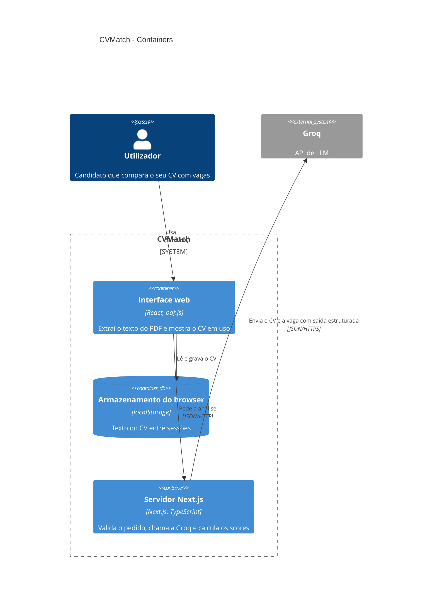

# Nível 2: Containers

> Última revisão: 2026-10-14 · Fontes: [PRD](../prd.md), [spec analise](../../specs/analise.md), código, ADRs listados abaixo

Mostra onde corre cada parte do CVMatch: o CV é extraído e guardado no browser, e só o servidor local fala com a Groq, com a chave da API.

## Elementos

| Elemento | Tipo | Tecnologia | Responsabilidade | ADR |
|---|---|---|---|---|
| Interface web | Container | React, pdf.js | Extrai o texto do PDF e mostra o CV em uso | [0001](../adr/0001-usar-pdfjs-dist-para-extrair-texto.md) |
| Armazenamento do browser | Base de dados | localStorage | Guarda o texto do CV entre sessões | — |
| Servidor Next.js | Container | Next.js, TypeScript | Valida o pedido, chama a Groq e calcula os scores; é o único que lê `GROQ_API_KEY` | — |
| Groq | Sistema externo | API de LLM | Classifica requisitos e propõe sugestões | [0002](../adr/0002-usar-qwen3-8-27b-na-analise.md) |

## Decisões relacionadas

- [ADR 0001: Usar pdfjs-dist para extrair o texto do CV no browser](../adr/0001-usar-pdfjs-dist-para-extrair-texto.md)
- [ADR 0002: Usar qwen/qwen3.8-27b da Groq para a análise do CV](../adr/0002-usar-qwen3-8-27b-na-analise.md)
