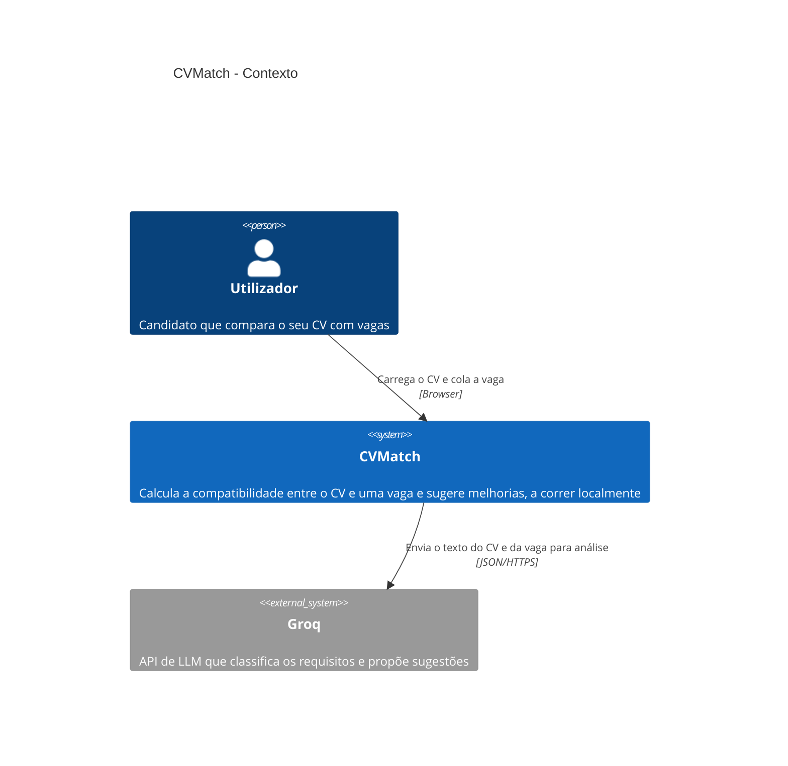

# Nível 1: Contexto

> Última revisão: 2026-10-14 · Fontes: [PRD](../prd.md), [spec analise](../../specs/analise.md), código, ADRs listados abaixo

Mostra quem usa o CVMatch e com que sistema externo ele fala. Útil para ver de relance para onde vão os dados do CV.

## Elementos

| Elemento | Tipo | Tecnologia | Responsabilidade | ADR |
|---|---|---|---|---|
| Utilizador | Pessoa | — | Dono do projeto, único utilizador | — |
| CVMatch | Sistema | Next.js | Extrai o CV, pede a análise e calcula os scores | [0001](../adr/0001-usar-pdfjs-dist-para-extrair-texto.md) |
| Groq | Sistema externo | API de LLM | Classifica requisitos e propõe sugestões | [0002](../adr/0002-usar-qwen3-8-27b-na-analise.md) |

## Decisões relacionadas

- [ADR 0001: Usar pdfjs-dist para extrair o texto do CV no browser](../adr/0001-usar-pdfjs-dist-para-extrair-texto.md)
- [ADR 0002: Usar qwen/qwen3.8-27b da Groq para a análise do CV](../adr/0002-usar-qwen3-8-27b-na-analise.md)
